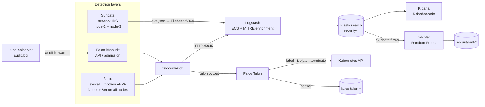
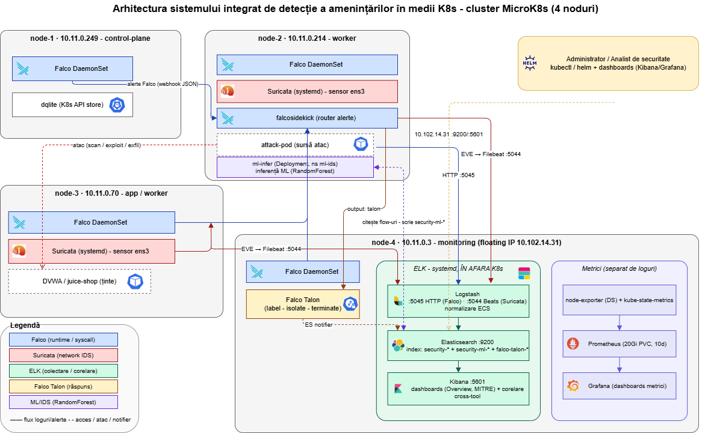
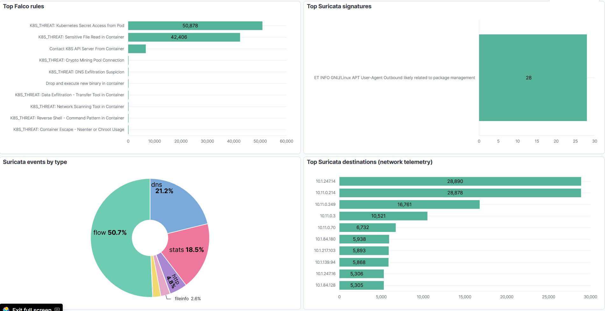
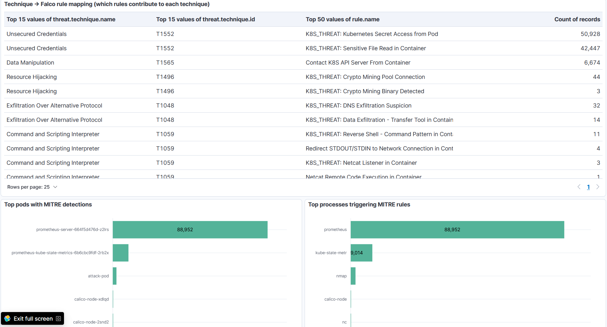
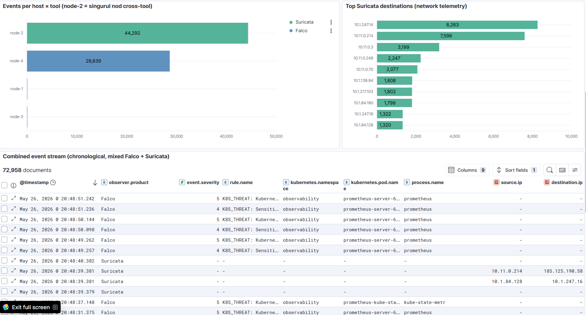
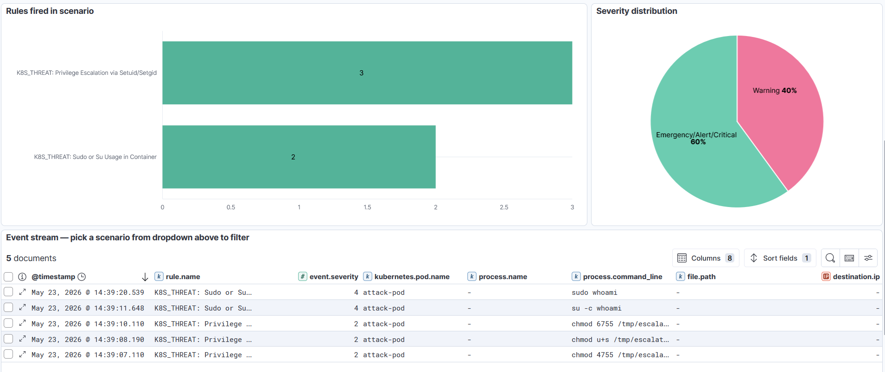
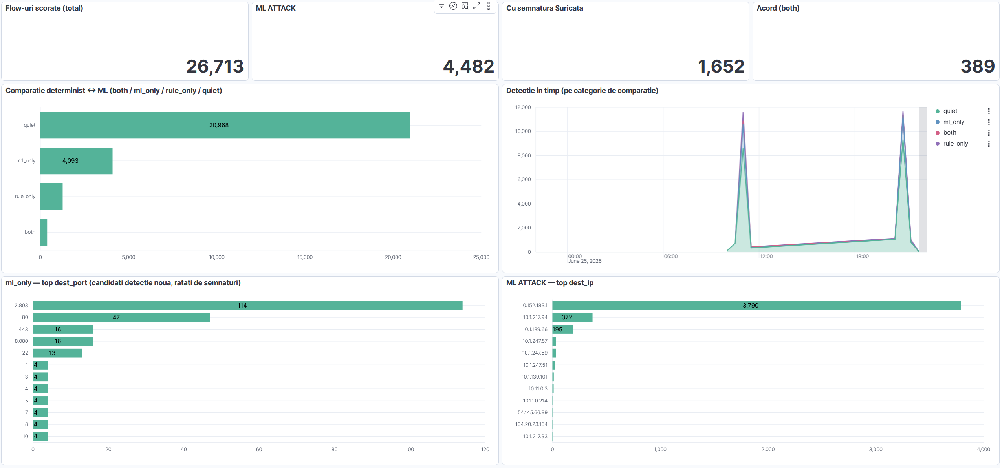

# Kubernetes Threat Detection System

**Multi-layer threat detection, correlation and automated response for Kubernetes.** Falco watches container runtime and Kubernetes API activity, Suricata watches network traffic, and the ELK Stack merges both into one correlated view. Falco Talon responds automatically, and an experimental Random Forest model gives a second opinion on network flows.

[](LICENSE)


Built as a bachelor's thesis project and validated end-to-end against **11 attack scenarios mapped to MITRE ATT&CK** on a 4-node MicroK8s cluster.

> [!NOTE]
> **Project status: complete.** The lab cluster (four Ubuntu VMs in a university datacenter) has since been decommissioned. The dashboards, screenshots and results in this repository were produced on that cluster. Everything needed to rebuild it is included; see [Reproducing the lab](#reproducing-the-lab).

[Why multiple layers](#why-multiple-layers) · [Architecture](#architecture) · [Detection coverage](#detection-coverage) · [Deterministic vs ML](#deterministic-vs-ml) · [Dashboards](#kibana-dashboards) · [Layout](#repository-layout) · [Reproducing](#reproducing-the-lab) · [Limitations](#known-limitations)

## Why multiple layers

Every detection tool has structural blind spots. This project combines three detection layers so that each one covers what the others cannot see:

| Layer | Tool | Sees | Cannot see |
|---|---|---|---|
| Host / runtime | **Falco**: modern eBPF, DaemonSet on every node, 18 custom `K8S_THREAT` rules | Process execution, file access and syscalls inside containers | Requests to the Kubernetes API, such as `kubectl apply` of a privileged pod |
| Kubernetes API / admission | **Falco k8saudit plugin**, fed from the API server audit log | Creation of privileged or host-mounted pods, access to secrets, RBAC changes | What runs inside a container afterwards |
| Network | **Suricata**: passive IDS on the node NIC, ET Open plus 3 custom rules | Web attacks, scans, DNS tunneling, east-west traffic between nodes | Loopback traffic, traffic between pods on the same node, encrypted payloads |

On top of the detection layers:

- **Correlation and analysis:** Logstash normalizes alerts from every source into the Elastic Common Schema (ECS) and maps them to MITRE ATT&CK techniques. Everything lands in a single Elasticsearch index that 5 Kibana dashboards read from.
- **Automated response:** Falco Talon reacts to Falco alerts by labeling the offending pod, isolating it with a NetworkPolicy, or terminating it.
- **ML second opinion (experimental):** a Random Forest scores every Suricata flow and writes its verdicts to a separate index, so you can compare them with signature-based detection. It adds to the rule-based layers and does not replace them.
- **Cluster metrics:** Prometheus and Grafana track node and control-plane health. They are kept separate from the security pipeline.

## Architecture



**Data flow.** Falco and k8saudit alerts reach Logstash through falcosidekick over HTTP. Suricata writes EVE JSON, which Filebeat ships to Logstash. Logstash processes every event in four stages: it tags the source, normalizes the fields to ECS, maps Falco rule tags to MITRE ATT&CK techniques, and auto-tags events with the attack scenario they belong to. All events go to one daily index, `security-YYYY.MM.dd`. Alerts from different tools can be correlated because they share fields:

- `kubernetes.pod.name` links Falco syscall alerts with k8saudit alerts.
- `destination.ip` links Falco with Suricata.
- `flow_id` links Suricata alerts with the ML verdicts.

### Cluster topology

| Node | Role | Node-specific components |
|---|---|---|
| node-1 | Control plane | MicroK8s control plane (dqlite), API server audit log + `audit-forwarder` |
| node-2 | Security worker | Suricata sensor (systemd), attacker pod `attack-pod`, `ml-infer` |
| node-3 | Application worker | Suricata sensor (systemd), targets: DVWA and OWASP Juice Shop |
| node-4 | Monitoring worker | Elasticsearch, Logstash and Kibana (systemd, outside Kubernetes) |

Falco runs on every node. Suricata sensors run on the nodes that host workloads and targets, so attack traffic crosses a sensor wherever it originates. The remaining components (falcosidekick, Falco Talon, Falco k8saudit, Prometheus, Grafana) run as ordinary Kubernetes workloads.

<details>
<summary>Detailed architecture diagram (Romanian labels)</summary>



More diagrams (log flow, attack → detection → response sequence, API-level detection, ML pipeline, metrics) are in [`docs/figures/`](docs/figures/). Their sources are in [`docs/diagrams/`](docs/diagrams/).
</details>

## Detection coverage

Each scenario folder in [`attack-scenarios/`](attack-scenarios/) contains an `attack.sh`, which runs the attack and then queries Elasticsearch for what fired, and an `expected-detections.md`, which records the expected rules, actual results and tuning history.

The numbers below are alert counts from the last full re-run (2026-07-13).

| # | Scenario | MITRE | Falco | k8saudit | Suricata | Talon | ML |
|---|---|---|:-:|:-:|:-:|:-:|:-:|
| 01 | Container escape: privileged pod, `nsenter`, `chroot`, runtime socket | T1611 | 13 | 4 | — | — | n/a |
| 02 | Crypto mining: renamed miner binaries, pool-port connections | T1496 | 18 | — | 3 | ✓ | partial |
| 03 | Reverse shell: `/dev/tcp`, FIFO, `nc -e`, listeners | T1059 | 34 | — | — ¹ | ✓ | n/a |
| 04 | Sensitive file / secret access: `/etc/shadow`, ServiceAccount token | T1552 | 6 | — | — | — | n/a |
| 05 | Network scanning: nmap TCP connect / SYN / version scans, `nc` | T1046 | 20 | — | 8 | — | ✓ |
| 06 | Privilege escalation: setuid bits, `su` / `sudo`, package install | T1548 | ~10 | — | — | — | n/a |
| 07 | Data exfiltration: HTTP POST, raw TCP, DNS tunneling | T1048 | 15 | — | 10 | — | ✓ |
| 08 | Malicious deployment: privileged pod, download + execute in `/tmp` | T1610 | 9 | 3 | — | — | n/a |
| 09 | OWASP ZAP DAST scan against DVWA | T1190 | 8 | — | 2,938 | — | ✓ |
| 10 | kube-hunter active Kubernetes pentest | T1046 / T1552 | 14 | — | 1 | — | minimal |
| 11 | Lateral movement: stolen ServiceAccount token → API pivot → east-west | T1550 / T1021 | 31 | — | 3 | — | ✓ |

<sub>¹ Loopback traffic never reaches a NIC, so the network layer cannot see it. "n/a" in the ML column marks a scenario with no network flows (syscall or API activity only).</sub>

What the matrix shows:

- **Every scenario is caught by at least one layer, and no single layer catches all of them.**
- **The API layer closes the deploy-time gap.** Falco cannot see a pod being created, only what it does once it runs. In scenarios 01 and 08, k8saudit flags the privileged pod at admission time (`Create Privileged Pod`, `Create Sensitive Mount Pod`, `Create HostPid Pod`, …).
- **The network layer covers Falco's gaps.** In scenario 07, Falco's DNS exfiltration rule never fires ([falco#3501](https://github.com/falcosecurity/falco/issues/3501)), but Suricata's custom rule `sid 1000012` catches the DNS tunnel. Scenario 09 is almost entirely network-visible: 2,938 Suricata alerts against 8 from Falco.
- **The runtime layer covers what the network cannot see:** loopback reverse shells (03), file access (04) and privilege escalation (06).
- **Response is automatic.** Talon labels and isolates the attacker pod about 3–5 seconds after the alert.

## Deterministic vs ML

[`ml-ids/`](ml-ids/) is an exploratory component. A Random Forest scores Suricata flows using native EVE features and writes its verdicts to the parallel index `security-ml-*`. The comparison is apples-to-apples: both detectors scored the same flows from controlled attack runs (scenarios 05, 09 and 11; 202 attack flows and 116 benign flows).

| Detector | Precision | Recall | F1 |
|---|:-:|:-:|:-:|
| Suricata signatures | 1.000 | 0.564 | 0.722 |
| Random Forest | 1.000 | 0.950 | 0.975 |
| Either one (union) | — | **0.975** | — |

- **The two detectors complement each other.** 41% of attack flows were caught only by the model. Signatures caught 2.5% that the model missed.
- **Domain shift is real.** A model trained on a public dataset scores F1 0.997 on that same dataset (CIC-IDS2017) but collapses to F1 0.0001 on a different one (CIC-UNSW-NB15).
- **Training on the cluster's own traffic fixes this.** Trained on this cluster's own Suricata flows, the model reaches F1 0.986 with 5-fold cross-validation.
- **The absolute scores are optimistic.** Benign traffic is dominated by easily separable infrastructure traffic (VXLAN, Calico, DNS). What matters here is the *comparison* between the two detectors.

Full write-ups: [`ml-ids/RESULTS.md`](ml-ids/RESULTS.md) (public datasets and domain shift) and [`ml-ids/study/REPORT.md`](ml-ids/study/REPORT.md) (deterministic vs ML study).

## Kibana dashboards

Five dashboards, each built by a Python script through the Kibana Saved Objects API and exported as NDJSON, ready to import:

| # | Dashboard | Answers |
|---|---|---|
| 01 | [Overview](dashboards/01-overview/) | What is the overall security posture? |
| 02 | [MITRE ATT&CK coverage](dashboards/02-mitre/) | Which techniques do the rules detect? |
| 03 | [Cross-tool correlation](dashboards/03-cross-tool/) | How do Falco and Suricata complement each other? |
| 04 | [Per-scenario investigation](dashboards/04-per-scenario/) | What did the system detect for one specific attack? |
| 05 | [Deterministic vs ML](dashboards/05-ml-comparison/) | What does the ML layer add over signatures? |



<details>
<summary>More screenshots</summary>

**MITRE ATT&CK coverage**


**Cross-tool correlation**


**Per-scenario investigation (scenario 06)**


**Deterministic vs ML**

</details>

## Repository layout

```
.
├── infrastructure/ansible/    # playbooks: 4 empty Ubuntu VMs → detection core
├── falco/
│   ├── config/                # Helm values with the custom K8S_THREAT rules (deployed source of truth)
│   └── rules/                 # older standalone copy of the rules, reference only, not deployed
├── falco-k8saudit/            # API / admission layer: audit policy, Helm values, audit-forwarder
├── falco-talon/               # automated response: Helm values, response rules, config override
├── suricata/                  # custom rules (sid 1000010–12), sensor runbook, logrotate config
├── elk/logstash/              # pipeline: Falco + Suricata → ECS + MITRE → security-*
├── observability/             # Prometheus + Grafana Helm values (cluster metrics)
├── attack-scenarios/          # 11 scenarios: attack.sh + expected-detections.md each
├── dashboards/                # 5 Kibana dashboards: build.py, exported NDJSON, screenshots
├── ml-ids/                    # Random Forest IDS: training, live inference, comparison study
│   ├── k8s/                   # in-cluster Deployment for live inference
│   └── study/                 # deterministic vs ML study
└── docs/
    ├── diagrams/              # draw.io + Mermaid sources
    └── figures/               # rendered diagrams
```

## Reproducing the lab

**You need:** four Ubuntu 22.04 VMs reachable over SSH, plus a workstation with Ansible, `kubectl`, Helm and Python 3.

**1. Deploy the detection core with Ansible.** This builds the MicroK8s cluster and installs Falco with the custom rules, Falco Talon, the Suricata sensors on node-2 and node-3, ELK on node-4, and the vulnerable target apps.

```bash
cd infrastructure/ansible
cp inventories/hosts.ini.example inventories/hosts.ini   # node IPs
cp group_vars/all.yml.example group_vars/all.yml         # CIDRs, MetalLB range, versions
ansible-playbook -i inventories/hosts.ini playbooks/site.yml
```

**2. Configure the endpoints.** Both files are gitignored.

```bash
cp .env.example .env                                                       # KIBANA_URL, ES_URL, data view IDs
cp falco/config/local-values.yaml.example falco/config/local-values.yaml   # Logstash webhook endpoint
```

**3. Add the remaining layers.** Each one has its own runbook:

- API / admission detection: [`falco-k8saudit/README.md`](falco-k8saudit/README.md)
- ML inference: [`ml-ids/README.md`](ml-ids/README.md). The trained model is not committed. Regenerate it from the included dataset with `python train_cluster_rf.py`.
- Cluster metrics: [`observability/`](observability/) (`prometheus-community/prometheus` and `grafana/grafana` charts)
- Kibana dashboards: [`dashboards/README.md`](dashboards/README.md)

**4. Run the attack scenarios.**

```bash
kubectl apply -f attack-scenarios/attack-target-setup.yaml
cd attack-scenarios/04-sensitive-file && ./attack.sh
```

Read [`attack-scenarios/README.md`](attack-scenarios/README.md) first. It covers the tools to install in `attack-pod`, the recommended run order, and the Talon cleanup required after scenarios 02 and 03, which leave the attacker pod isolated.

## Known limitations

- **Falco UDP enrichment.** With the modern eBPF driver, rules that depend on UDP socket details (`DNS Exfiltration Suspicion`, `Crypto Mining Pool Connection`) do not fire ([falco#3501](https://github.com/falcosecurity/falco/issues/3501)). Suricata covers DNS exfiltration instead.
- **Network sensor visibility.** Suricata only sees traffic that crosses the NIC of a node with a sensor. Same-node pod-to-pod traffic, loopback and TLS-encrypted payloads are invisible to it. Calico SNAT on egress also hides which pod originated outbound traffic.
- **Known false positive.** The file-integrity rule fires when `ldconfig` writes `/etc/ld.so.cache~` during package installs (scenarios 06 and 08).
- **Falco Talon chart 0.4.0 bugs.** Two template bugs make it impossible to configure Talon through Helm values alone, so the native config is applied as a secret override. See [`falco-talon/README.md`](falco-talon/README.md).
- **Lab-grade topology.** There is a single control-plane node (no HA), and ELK runs as systemd services outside the cluster.

## Security notice

> [!WARNING]
> This is a lab project. It deploys intentionally vulnerable applications (DVWA, OWASP Juice Shop), privileged pods and real attack tooling (nmap, OWASP ZAP, kube-hunter). The ELK stack runs **without authentication or TLS** (`xpack.security.enabled: false`). Run it only in an isolated environment you own, never on shared or production infrastructure.

## Documentation language

This README is in English. The per-component documentation (runbooks, `expected-detections.md` files, ML results) is written in Romanian.

## License

[MIT](LICENSE) © 2026 Tatar Ioan Dan
